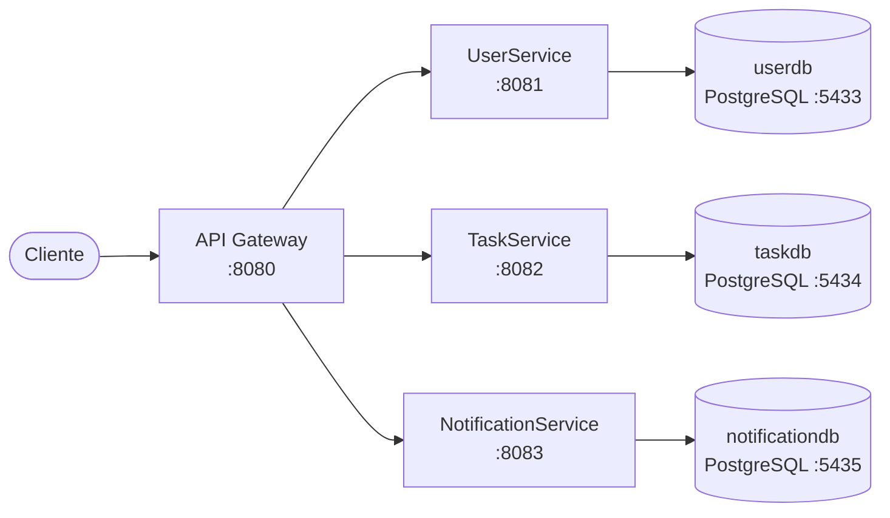

# Gerenciador de Tarefas

Sistema de gerenciamento de tarefas baseado em microsserviços com **Java 25**, **Spring Boot 4.2.0** e **PostgreSQL 17**, totalmente containerizado com Docker Compose.

> **Status:** projeto em desenvolvimento. A estrutura dos microsserviços, os bancos de dados e o ambiente Docker já estão funcionais; as regras de negócio e as rotas do API Gateway ainda estão sendo implementadas.

## Sumário

- [Arquitetura](#arquitetura)
- [Tecnologias](#tecnologias)
- [Estrutura do projeto](#estrutura-do-projeto)
- [Serviços e portas](#serviços-e-portas)
- [Pré-requisitos](#pré-requisitos)
- [Configuração](#configuração)
- [Como executar](#como-executar)
- [Desenvolvimento com hot reload](#desenvolvimento-com-hot-reload)
- [Testando os serviços](#testando-os-serviços)
- [Variáveis de ambiente](#variáveis-de-ambiente)
- [Decisões de arquitetura](#decisões-de-arquitetura)
- [Segurança](#segurança)
- [Roadmap](#roadmap)

## Arquitetura



- **API Gateway**: ponto de entrada único da aplicação.
- **UserService**: gerenciamento de usuários.
- **TaskService**: gerenciamento de tarefas.
- **NotificationService**: envio e registro de notificações.
- **Database per service**: cada microsserviço possui seu próprio banco PostgreSQL e volume persistente.

> As rotas do API Gateway para os microsserviços ainda não estão configuradas. Por enquanto, apenas o endpoint `/ping` do `UserService` está implementado.

## Tecnologias

| Categoria | Tecnologia |
| --- | --- |
| Linguagem | Java 25 |
| Framework | Spring Boot 4.2.0 |
| Cloud | Spring Cloud 2026.0.0-SNAPSHOT (Gateway Server WebMVC) |
| Persistência | Spring Data JPA / Hibernate |
| Banco de dados | PostgreSQL 17 (Alpine) |
| Segurança | Spring Security |
| Build | Maven (Maven Wrapper incluído) |
| Containerização | Docker multi-stage + Docker Compose |
| Produtividade | Lombok, Spring Boot DevTools, Actuator (Gateway) |

## Estrutura do projeto

```text
GerenciadorDeTarefas/
├── ApiGateway/                 # API Gateway (porta 8080)
│   ├── Dockerfile
│   ├── pom.xml
│   └── src/
├── UserService/                # Microsserviço de usuários (porta 8081)
│   ├── Dockerfile
│   ├── pom.xml
│   └── src/
├── TaskService/                # Microsserviço de tarefas (porta 8082)
│   ├── Dockerfile
│   ├── pom.xml
│   └── src/
├── NotificationService/        # Microsserviço de notificações (porta 8083)
│   ├── Dockerfile
│   ├── pom.xml
│   └── src/
├── docker/
│   └── dev/
│       └── Dockerfile          # Imagem Maven para o modo de desenvolvimento
├── docker-compose.yml          # Ambiente de produção (jars empacotados)
├── docker-compose.dev.yml      # Override para desenvolvimento com hot reload
├── .env.example                # Modelo das variáveis de ambiente
├── .dockerignore
├── .gitignore
└── README.md
```

## Serviços e portas

| Serviço | Porta no host | Porta no container | Banco de dados | Porta do banco no host |
| --- | --- | --- | --- | --- |
| `api-gateway` | 8080 | 8080 | — | — |
| `user-service` | 8081 | 8080 | `userdb` | 5433 |
| `task-service` | 8082 | 8080 | `taskdb` | 5434 |
| `notification-service` | 8083 | 8080 | `notificationdb` | 5435 |

Todas as portas podem ser alteradas no arquivo `.env`.

## Pré-requisitos

- [Docker](https://docs.docker.com/get-docker/) 24+
- [Docker Compose](https://docs.docker.com/compose/) v2

Opcional, para executar os serviços fora do Docker:

- Java 25
- Maven 3.9+ (ou use o `mvnw` incluído em cada serviço)

## Configuração

Crie o arquivo `.env` a partir do modelo:

```bash
cp .env.example .env
```

O `.env` é ignorado pelo Git, portanto credenciais locais não são versionadas. Ajuste as variáveis conforme necessário (veja a [tabela completa](#variáveis-de-ambiente)).

## Como executar

### Ambiente de produção (jars empacotados)

Na raiz do projeto:

```bash
docker compose up -d --build
```

Verifique o status dos containers:

```bash
docker compose ps
```

Acompanhe os logs:

```bash
docker compose logs -f
# ou um serviço específico
docker compose logs -f user-service
```

Para parar os serviços:

```bash
docker compose down
```

Para parar e **remover também os dados** dos bancos:

```bash
docker compose down -v
```

### Build das imagens

Cada microsserviço possui um `Dockerfile` multi-stage:

1. **Build:** imagem `maven:3.10.0-eclipse-temurin-25-noble` compila o projeto e gera o jar.
2. **Runtime:** imagem `eclipse-temurin:25-jre-noble` executa somente o jar.

As imagens rodam com o usuário `appuser` (sem privilégios) e aproveitam o cache de dependências do Maven.

## Desenvolvimento com hot reload

O arquivo `docker-compose.dev.yml` sobrescreve os serviços para usar o código do host via bind mount, com o Spring Boot DevTools reiniciando a aplicação a cada recompilação.

```bash
docker compose -f docker-compose.yml -f docker-compose.dev.yml up -d --build
```

O código-fonte de cada serviço é montado em `/workspace` e as dependências do Maven ficam no volume `maven-cache`. Se a IDE não compilar automaticamente, force a compilação dentro do container:

```bash
docker compose -f docker-compose.yml -f docker-compose.dev.yml exec user-service mvn -q compile
```

> No modo de desenvolvimento, os containers usam o UID/GID do usuário local (`UID` e `GID` no `.env`) para evitar arquivos criados como `root` na pasta `target/`.

## Testando os serviços

O `UserService` expõe um endpoint público de verificação:

```bash
curl http://localhost:8081/ping
# resposta: pong
```

Os demais endpoints de negócio ainda serão implementados. O API Gateway está disponível em `http://localhost:8080`, mas ainda sem rotas configuradas.

## Variáveis de ambiente

| Variável | Padrão | Descrição |
| --- | --- | --- |
| `POSTGRES_USER` | `postgres` | Usuário dos bancos PostgreSQL |
| `POSTGRES_PASSWORD` | `postgres` | Senha dos bancos PostgreSQL |
| `UID` | `1000` | UID do usuário local (modo dev) |
| `GID` | `1000` | GID do usuário local (modo dev) |
| `GATEWAY_PORT` | `8080` | Porta do API Gateway no host |
| `USER_SERVICE_PORT` | `8081` | Porta do UserService no host |
| `TASK_SERVICE_PORT` | `8082` | Porta do TaskService no host |
| `NOTIFICATION_SERVICE_PORT` | `8083` | Porta do NotificationService no host |
| `USER_DB_PORT` | `5433` | Porta do banco `userdb` no host |
| `TASK_DB_PORT` | `5434` | Porta do banco `taskdb` no host |
| `NOTIFICATION_DB_PORT` | `5435` | Porta do banco `notificationdb` no host |

As configurações de conexão dos serviços são injetadas pelo `docker-compose.yml` por meio de variáveis do Spring (`SPRING_DATASOURCE_URL`, `SPRING_DATASOURCE_USERNAME`, `SPRING_DATASOURCE_PASSWORD`).

## Decisões de arquitetura

- **Banco de dados por serviço:** isolamento de dados entre os microsserviços, cada um com seu próprio PostgreSQL e volume Docker.
- **Comunicação via rede Docker:** todos os serviços compartilham a rede bridge `gerenciador-net` e se referenciam pelo nome do serviço (ex.: `user-db:5432`).
- **Healthchecks nos bancos:** os microsserviços só iniciam após o banco correspondente estar saudável (`depends_on` com `condition: service_healthy`).
- **Hibernate `ddl-auto=update`:** usado no ambiente atual para criar/atualizar o schema automaticamente. Para produção, o recomendado é adotar migrations versionadas (Flyway ou Liquibase).
- **Multi-stage build:** imagem final enxuta com apenas o JRE e execução como usuário sem privilégios.
- **Persistência:** os dados dos bancos ficam nos volumes nomeados `user-db-data`, `task-db-data` e `notification-db-data`.

## Segurança

- O `UserService` permite acesso público apenas ao endpoint `/ping`; demais requisições exigem autenticação básica.
- CSRF está desabilitado no `UserService` por se tratar de uma API REST.
- As credenciais padrão (`postgres`/`postgres`) são apenas para desenvolvimento. **Altere-as no `.env` antes de qualquer uso real.**
- O `.env` não é versionado; apenas o `.env.example` é mantido no repositório.

## Roadmap

- [x] Estrutura inicial dos quatro microsserviços
- [x] Dockerfiles multi-stage com execução como usuário não-root
- [x] Docker Compose para produção e desenvolvimento (hot reload)
- [x] Um banco PostgreSQL isolado por serviço
- [x] Endpoint público `/ping` no `UserService`
- [ ] Configuração das rotas no API Gateway
- [ ] CRUD de usuários, tarefas e notificações
- [ ] Autenticação e autorização com JWT
- [ ] Migrations de banco com Flyway ou Liquibase
- [ ] Testes de integração entre os serviços
- [ ] CI/CD e publicação das imagens

## Licença

Este projeto ainda não possui uma licença definida.
